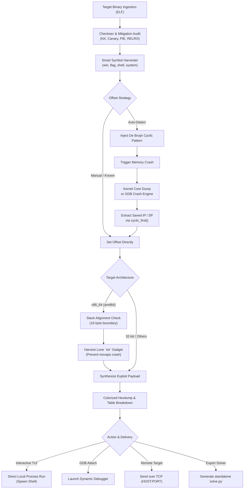

<p align="center">
  <pre align="center">
<font color="#00ffff"><b> ██████╗ ███████╗████████╗██████╗ ██╗    ██╗██╗███╗   ██╗</b></font>
<font color="#00d7ff"><b> ██╔══██╗██╔════╝╚══██╔══╝╚════██╗██║    ██║██║████╗  ██║</b></font>
<font color="#00afff"><b> ██████╔╝█████╗     ██║    █████╔╝██║ █╗ ██║██║██╔██╗ ██║</b></font>
<font color="#0087ff"><b> ██╔══██╗██╔══╝     ██║   ██╔═══╝ ██║███╗██║██║██║╚██╗██║</b></font>
<font color="#005fff"><b> ██║  ██║███████╗   ██║   ███████╗╚███╔███╔╝██║██║ ╚████║</b></font>
<font color="#5f00ff"><b> ╚═╝  ╚═╝╚══════╝   ╚═╝   ╚══════╝ ╚══╝╚══╝ ╚═╝╚═╝  ╚═══╝</b></font>
  </pre>
</p>

<h3 align="center"><b>Automated CTF Return-to-Win Exploitation Toolkit & Interactive TUI</b></h3>

<p align="center">
  <i>Supercharge your binary exploitation workflow. Zero-guesswork crash analysis, checksec auditing, stack alignment hunting, colorized payload breakdowns, and instant remote flag captures.</i>
</p>

<p align="center">
  <a href="https://pypi.org/project/ret2win/"></a>
  <a href="https://github.com/Vishal-07-R/Ret2Win/releases"></a>
  <a href="https://python.org"></a>
  <a href="https://github.com/Gallopsled/pwntools"></a>
  <a href="https://github.com/Vishal-07-R/Ret2Win/blob/main/LICENSE"></a>
  <a href="https://archlinux.org"></a>
</p>

---

## ⚡ Overview

**Ret2Win** is a modern binary exploitation toolkit engineered specifically for CTF players, security researchers, and exploit developers. 

In traditional CTF competitions, solving a classic `ret2win` challenge typically involves repeated manual steps:
1. Running `checksec` on the binary.
2. Disassembling symbols with `objdump`, `readelf`, or Ghidra to spot target functions.
3. Launching GDB, generating cyclic patterns, crashing the binary, copying addresses, and running `cyclic -l`.
4. Calculating stack padding, hunting lone `ret` gadgets for 16-byte stack alignment (`movaps` crash prevention), and drafting an exploit script.

**Ret2Win completely automates this lifecycle.** It analyzes the ELF binary, detects checksec mitigations, locates win functions, fuzzes the exact offset using native core dumps (with automatic GDB fallback), crafts the payload, guarantees 16-byte stack alignment, and either drops you into an interactive shell or generates a standalone, clean `solve.py` script—**in under 3 seconds**.

Available both as a **rich, split-scrolling Cyberpunk Terminal User Interface (TUI)** and as a **fully scriptable CLI tool**.

---

## ✨ Features

- 🎯 **Automated Zero-Guesswork Offset Detection**
  - Injects De Bruijn cyclic patterns and captures crash state via Linux core dumps.
  - Automatically inspects `RIP`, `EIP`, `PC`, `RSP`, and stack frames.
  - Built-in fallback engine directly queries GDB if kernel core dumping is restricted.
  - Includes offset validation (`--validate-offset`) to verify control flow redirection with canary crash markers before firing.

- 🛡️ **Instant Checksec & ELF Mitigation Auditing**
  - Inspects Canary, NX (Non-Executable Stack), PIE (Position Independent Executable), RELRO (Partial/Full), and Fortify.
  - Automatically warns if a PIE binary requires runtime base address resolution.

- 🔎 **Smart Win Symbol Discovery**
  - Scans symbol tables and strings for CTF win candidates (`win`, `flag`, `shell`, `print_flag`, `get_flag`, `system`, `vuln_target`, `backdoor`, etc.).
  - Interactive symbol browser to inspect and select any function symbol directly.

- 📐 **Automatic x86_64 Stack Alignment & Lone `ret` Hunting**
  - Fixes the notorious x86_64 `movaps` crash on modern libc (`system()`, `puts()`, `do_system` requiring 16-byte aligned stacks).
  - Automatically harvests lone `ret` gadgets (`0xc3`) using ROP gadgets and binary opcode inspection.

- 🎮 **Cyberpunk Interactive Terminal UI (TUI)**
  - Pinned dashboard featuring live status messages, binary mitigation status, payload stats, and quick actions.
  - Native DECSTBM scroll region support: dashboard stays pinned on top while your interactive prompts and command output scroll smoothly below.
  - Dynamic hotkeys for binary loading, offset tuning, win target selection, and payload inspection.

- 🔬 **Colorized Split Hexdump & Payload Breakdown**
  - Real-time payload visualizer with colored byte breakdowns:
    - 🟦 **Padding bytes** (`0x41` 'A' pattern)
    - 🟨 **Stack Alignment Gadget** (Lone `ret`)
    - 🟩 **Target Return Address** (`win` entrypoint)
  - Detailed breakdown table listing offsets, byte lengths, and target hex values.

- 🚀 **1-Click Multi-Target Deployment & Code Generation**
  - **Local Execution**: Launches the binary locally in a PTY and hands control over to an interactive shell (`io.interactive()`).
  - **GDB Debugger Session**: Spawns GDB attached to the target binary with your payload pre-loaded.
  - **Remote Server Attack**: Connects over TCP sockets to remote challenge servers (`HOST:PORT`) and captures the flag.
  - **Clean `solve.py` Exporter**: Generates a self-contained, documented Python pwntools solve script ready for your CTF writeup.

- 🌐 **Multi-Architecture & Cross-Emulation Ready**
  - Fully supports `x86_64`, `i386`, `ARM`, `AArch64`, `MIPS`, `RISC-V`.
  - Integrates with QEMU user-mode emulation (`qemu-arm`, `qemu-mips`, etc.) and detects `binfmt_misc`.

- 📋 **Integrated Clipboard & In-App Pager**
  - One-click payload copying to system clipboard via `wl-clipboard` (Wayland), `xclip` / `xsel` (X11), or `pbcopy` (macOS).
  - Built-in multi-topic CTF manual and keyboard documentation viewable via pager (`less`).

---

## 🏗️ Architecture & Exploitation Workflow



---

## 🖥️ Terminal UI Showcase

Launch the interactive interface with a single command:
```bash
ret2win
```

```text
 ┌────────────────────────────────────────────────────────────────────────────────────────┐
 │  ██████╗ ███████╗████████╗██████╗ ██╗    ██╗██╗███╗   ██╗   Ret2Win CTF Exploitation   │
 │  Automated CTF Return-to-Win Exploitation Toolkit  •  made by -Casper • v1.3.1         │
 ├────────────────────────────────────────────────────────────────────────────────────────┤
 │ Target Binary : ./vuln [ELF 64-bit | x86-64 | Little Endian]                          │
 │ Mitigations   : Canary: NO | NX: YES | PIE: NO | RELRO: Partial                        │
 │ Target Symbol : win -> 0x401196                                                        │
 │ Crash Offset  : 88 bytes (Auto-detected & Verified)                                    │
 │ Alignment     : 16-Byte Stack Align Enabled (ret -> 0x40101a)                          │
 │ Delivery Mode : stdin                                                                  │
 │ Destination   : Local Process                                                          │
 │ Payload Size  : 104 bytes                                                              │
 ├────────────────────────────────────────────────────────────────────────────────────────┤
 │ [1] Select Binary    [2] Auto-Detect Offset   [3] Validate Offset  [4] Target Function │
 │ [5] Toggle Align     [6] Delivery Mode        [7] Remote Target    [8] Inspect Payload │
 │ [9] Browse Symbols   [G] Generate Payload     [F] Fire Exploit     [H] Help   [Q] Quit │
 └────────────────────────────────────────────────────────────────────────────────────────┘
```

### Colorized Payload Inspection
Ret2Win visually separates every component of the attack buffer:

```text
  00000000:  41 41 41 41 41 41 41 41  41 41 41 41 41 41 41 41   AAAAAAAAAAAAAAAA
  ...
  00000050:  41 41 41 41 41 41 41 41  1a 10 40 00 00 00 00 00   AAAAAAAA..@.....
  00000060:  96 11 40 00 00 00 00 00                            ..@.....

  Legend:
  • 0x00 - 0x57 [88 bytes] : Cyclic Padding ('A' * 88)
  • 0x58 - 0x5F [ 8 bytes] : Lone `ret` Gadget (0x40101a) [Stack Alignment]
  • 0x60 - 0x67 [ 8 bytes] : Target `win()` Address (0x401196)
```

---

## 🚀 Installation

Ret2Win can be installed via **PyPI**, the **universal installer script**, or directly from source.

### Method 1: Install from PyPI (Simplest)

Install globally via `pipx` or inside a virtual environment:

```bash
# Recommended for CLI tools on modern Linux (PEP 668)
pipx install ret2win

# Or via standard pip in your active environment
pip install ret2win
```

---

### Method 2: Universal Automated Installer (Recommended for Local Git Repo)

Clone the repository and run the installer:

```bash
git clone https://github.com/Vishal-07-R/Ret2Win.git
cd Ret2Win
./install.sh
```

#### Installer Options:
```bash
./install.sh                # User-space install (~/.local/share/ret2win and ~/.local/bin/ret2win)
./install.sh -y             # Silent, non-interactive automated install
sudo ./install.sh --system  # System-wide install for all users (/usr/local/bin/ret2win)
./install.sh --dev          # Developer symlink mode (links directly to active repo)
./install.sh --check        # Audit system dependencies and coredump configuration
./install.sh --uninstall    # Clean uninstallation of Ret2Win and launcher links
```

---

### Method 3: From Source (`git`)

#### Using `pipx` (Isolated user application):
```bash
pipx install .
```

#### Using `pip` with Virtual Environment:
```bash
python3 -m venv venv
source venv/bin/activate
pip install -r requirements.txt
pip install -e .
```

---

### Distribution Prerequisites

Ret2Win utilizes standard Linux tools for binary inspection and crash capturing. The `install.sh` script will automatically offer to install these for you:

#### Arch Linux / CachyOS / Manjaro
```bash
sudo pacman -S python python-pip gdb wl-clipboard xclip qemu-user qemu-user-binfmt
```

#### Debian / Ubuntu / Kali / Parrot OS
```bash
sudo apt update
sudo apt install python3 python3-pip python3-venv gdb wl-clipboard xclip qemu-user qemu-user-static
```

#### Fedora / RHEL
```bash
sudo dnf install python3 python3-pip python3-virtualenv gdb wl-clipboard xclip qemu-user-static
```

---

## ⚡ Core Dump Optimization (Zero-Guesswork Offset Finding)

To let Ret2Win automatically calculate buffer overflow offsets using native Linux core dumps without GDB delay:

1. Enable unlimited core dumps in your shell:
   ```bash
   ulimit -c unlimited
   ```
   *(Add `ulimit -c unlimited` to your `~/.bashrc` or `~/.zshrc` so it is always active).*

2. (Optional) If running on Ubuntu/Debian with Apport or systemd-coredump:
   ```bash
   sudo sysctl -w fs.suid_dumpable=1
   ```
   *Note: Even if core dumping is restricted by your kernel, Ret2Win automatically falls back to an integrated GDB crash tracing engine seamlessly.*

---

## 📖 CLI Usage & Command Reference

Ret2Win can be driven completely headless in automation pipelines, CTF scripts, or CI/CD testing.

### Command-Line Arguments

| Argument | Type | Default | Description |
|:---|:---:|:---:|:---|
| `--binary` | `PATH` | *None* | Path to target ELF binary executable |
| `--win-addr` | `HEX/SYM` | *None* | Target win function address (e.g. `0x401196`) or symbol name (`win`) |
| `--offset` | `INT` | *Auto* | Manually specify buffer overflow offset (skips auto-detection) |
| `--max-len` | `INT` | `2048` | Maximum De Bruijn pattern length for crash auto-detection |
| `--align` | `FLAG` | `False` | Add 16-byte stack alignment padding (lone `ret`) before jumping to win |
| `--ret-gadget` | `HEX/SYM` | *Auto* | Address or symbol of a lone `ret` instruction |
| `--input-mode` | `stdin\|argv`| `stdin` | How input is delivered to vulnerable program buffer |
| `--output` | `PATH` | `payload.bin` | File path to write raw binary payload bytes |
| `--run` | `FLAG` | `False` | Spawn target binary locally, transmit payload, and open interactive shell |
| `--remote` | `HOST PORT`| *None* | Connect to remote network socket, transmit payload, and open interactive shell |
| `--script` | `PATH` | *None* | Generate a standalone, documented `solve.py` script and exit |
| `--validate-offset` | `FLAG` | `False` | Validate computed offset with a controlled marker crash |
| `--tui` | `FLAG` | `False` | Launch the interactive Terminal User Interface |
| `--no-color` | `FLAG` | `False` | Strip Rich ANSI color codes and formatting |
| `--version` | `FLAG` | *None* | Display version information and exit |

---

## 🎯 Practical CTF Cookbooks

### 1. Zero-Config Local Exploit & Shell
Automatically find the offset, target the `win` function, and drop into an interactive shell:
```bash
ret2win --binary ./vuln --win-addr win --run
```

### 2. 64-bit Stack Alignment (`movaps` crash prevention)
When targeting 64-bit binaries on modern Linux distributions (Ubuntu 18.04+, Debian, Arch) where libc functions crash at `movaps`:
```bash
ret2win --binary ./vuln --win-addr win --align --run
```

### 3. Generate a Standalone `solve.py` for CTF Submission
Generate a modular, production-ready exploit script configured for the competition's remote server:
```bash
ret2win --binary ./chall --win-addr 0x401176 --align --remote 10.10.10.42 1337 --script solve.py
```

### 4. Argv-Based Vulnerability
When the target program reads input from command line arguments (`argv[1]`):
```bash
ret2win --binary ./cli_vuln --win-addr win --input-mode argv --run
```

### 5. Validate Offset Before Exploitation
Test and confirm the offset via canary crash marker verification before executing:
```bash
ret2win --binary ./vuln --win-addr win --validate-offset --run
```

---

## 💡 Troubleshooting & CTF Deep-Dive

<details>
<summary><b>1. Why does my payload crash inside <code>system()</code> or <code>puts()</code>? (Stack Alignment)</b></summary>

### The 16-Byte Stack Alignment Rule (x86_64)
The AMD64 System V ABI mandates that before a `call` instruction is executed, the stack pointer (`rsp`) must be **16-byte aligned** (`rsp % 16 == 0`). When a function is called, the CPU pushes the 8-byte return address onto the stack, leaving `rsp` aligned to `8 (mod 16)`.

Modern glibc implementations make extensive use of SSE instructions (such as `movaps` or `movdqa`), which require memory operands to be strictly 16-byte aligned. If the stack is misaligned when entering `system()`, `do_system()`, or `puts()`, the program triggers a `SIGSEGV` at the `movaps` instruction.

**The Fix:**
Ret2Win's `--align` switch automatically prepends a lone `ret` gadget address to the payload before `win()`. Executing `ret` pops 8 bytes off the stack, re-aligning `rsp` to 16 bytes and allowing SSE instructions to execute without crashing.
</details>

<details>
<summary><b>2. Why does <code>argv</code> mode reject my payload? (NUL Byte Termination)</b></summary>

### The C String Terminator Limitation
Under Linux and POSIX systems, `argv[]` strings passed via `execve()` are null-terminated C strings. If an address contains a null byte (`0x00`) anywhere prior to its final byte (which is standard for 64-bit addresses like `0x0000000000401196`), the kernel truncates the argument at the first `0x00`.

**The Solution:**
If the binary supports reading from standard input, switch to `--input-mode stdin`. If `argv` is mandatory, choose an address or gadget free of embedded null bytes.
</details>

<details>
<summary><b>3. How does Ret2Win handle Position Independent Executables (PIE)?</b></summary>

### PIE / ASLR Handling
When a binary is compiled with PIE enabled, code addresses are randomized on each execution. Static addresses shown in `objdump` or `readelf` are relative offsets (e.g. `0x1196`), not runtime addresses.

**The Solution:**
When Ret2Win detects PIE, it warns the user. In the interactive TUI, you can supply either the runtime base address or compute `base + offset` after leaking a pointer.
</details>

---

## 🤝 Contributing

Contributions, issues, and feature requests are welcome!
Feel free to check the [Issues page](https://github.com/Vishal-07-R/Ret2Win/issues).

1. Fork the Project (`https://github.com/Vishal-07-R/Ret2Win/fork`)
2. Create your Feature Branch (`git checkout -b feature/AmazingFeature`)
3. Commit your Changes (`git commit -m 'Add some AmazingFeature'`)
4. Push to the Branch (`git push origin feature/AmazingFeature`)
5. Open a Pull Request

---

## 📜 License

Distributed under the **MIT License**. See [`LICENSE`](./LICENSE) for more information.

---

## 👤 Author

**Casper (Vishal-07-R)**
- GitHub: [@Vishal-07-R](https://github.com/Vishal-07-R)
- Focus: CTF Competitions, Binary Exploitation, Reverse Engineering, Cybersecurity

<p align="center">
  <b>Happy Hacking! May your return addresses always land true. 🚩</b>
</p>
